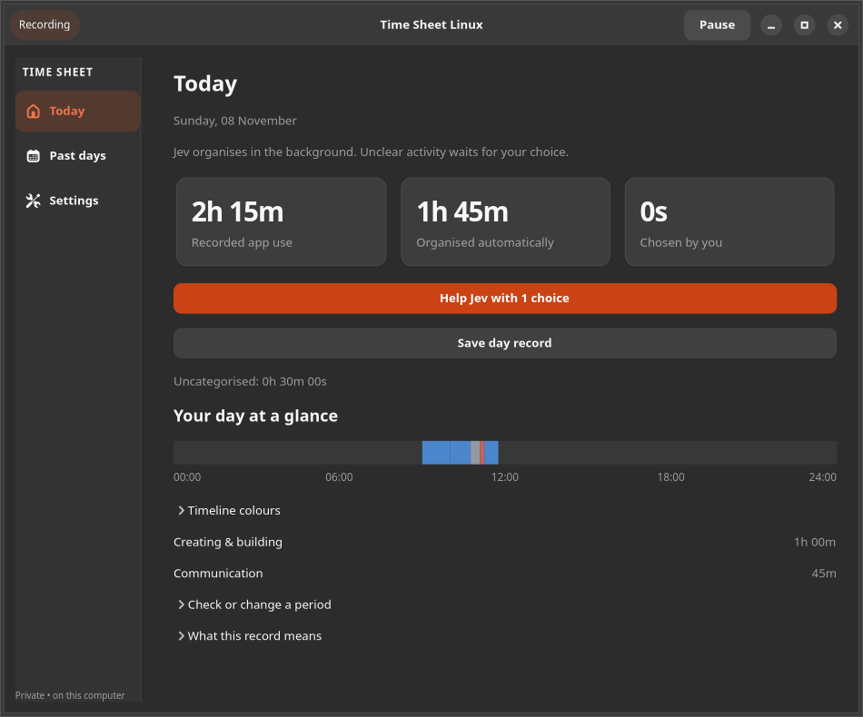

# Time Sheet Linux

A private Linux desktop app for recording foreground app use, assigning activity to projects and creating client timesheets. Your data stays on your computer; an account or cloud service is not required.



## Install

Install **Time Sheet Linux 0.3.0-rc3** using either the AppImage or terminal commands. This is a prerelease: desktop support is still being tested, and the downloads are unsigned. Back up existing data before upgrading.

### Option 1: AppImage

For x86-64 Linux with glibc 2.39 or newer:

1. Download the [AppImage](https://github.com/peternewing/timesheet-linux/releases/download/v0.3.0-rc3/TimeSheetLinux-x86_64.AppImage) and [SHA256SUMS](https://github.com/peternewing/timesheet-linux/releases/download/v0.3.0-rc3/SHA256SUMS) into a permanent folder.
2. Open a terminal in that folder and run:

   ```sh
   sha256sum --ignore-missing -c SHA256SUMS
   ```

   Check that the AppImage says **OK**, then run:

   ```sh
   chmod +x TimeSheetLinux-x86_64.AppImage
   ./TimeSheetLinux-x86_64.AppImage --diagnose
   ./TimeSheetLinux-x86_64.AppImage --install
   ```

3. Open **Time Sheet Linux** from Applications. Keep the AppImage in that folder; the launcher and background service use it.

### Option 2: Terminal installation from source

For Ubuntu 24.04+ or Debian 13+, open a terminal and run:

```sh
sudo apt update
sudo apt install git python3-gi python3-gi-cairo gir1.2-gtk-4.0 gir1.2-adw-1 python3-reportlab fonts-dejavu-core
git clone --branch v0.3.0-rc3 https://github.com/peternewing/timesheet-linux.git timesheet-linux-0.3
cd timesheet-linux-0.3
/usr/bin/python3 -m timesheet.diagnostics
./install.sh
```

Run `./install.sh` as your normal user, not with `sudo`, and keep the folder in place. Open **Time Sheet Linux** from Applications. For Fedora, Arch, openSUSE and desktop-specific setup, see the [complete installation guide](docs/INSTALL.md). The command above selects the release tag because the default branch still contains older source code.

On GNOME 50 Wayland, sign out and back in once to load the helper. Other desktops may need extra setup; see the [desktop instructions](docs/INSTALL.md#desktop-setup).

## How it works

- Records the foreground application and separates idle, locked, excluded and missing periods from active work.
- Lets you create projects, assign activity, add manual time, review drafts and approve work before billing.
- Saves rates and report snapshots. Exports CSV, printable HTML, PDF reports and invoice drafts.
- Runs a per-user collector and supports local backups, restore, retention settings and app exclusions.

Invoice PDFs are **drafts**: they do not calculate tax or automatically mark work billed. A foreground app is evidence of usage, not proof that time is billable. Review activity before invoicing.

## Compatibility

| Desktop session | Automatic tracking in 0.3.0-rc3 |
|---|---|
| GNOME 50 Wayland | Supported |
| Plasma 6 Wayland | Capture helper + `swayidle` |
| Sway Wayland | IPC + `swayidle` and a supported lock service |
| Hyprland Wayland | Experimental; real GPU-backed testing pending |
| EWMH X11 | X11 adapter and supported lock service |
| Other Wayland desktops | Manual time until an adapter is available |

GNOME 50, Plasma 6 and Sway focus/idle were exercised in isolated sessions; X11 was checked on a virtual server. Hardware lock/suspend, Hyprland and additional distributions need further testing. Missing capture evidence is recorded as unknown, not active work. See [compatibility and test details](docs/LINUX_COMPATIBILITY.md).

## Privacy and data

By default, the database and backups are under `~/.local/share/time-sheet-linux/`; source and AppImage installs follow `XDG_DATA_HOME` if set. Data is local and user-only, but **not encrypted**. Window titles are off by default. No keystrokes, screenshots, clipboard contents or browser URLs are recorded.

Keep an external backup if you need protection from disk loss. Uninstalling integration keeps the database and backups. See [privacy and security](SECURITY.md) and [backup and restore](docs/INSTALL.md#backup-and-restore).

## Contributing

Run `/usr/bin/python3 -m unittest discover -s tests -v` and see [contributing](CONTRIBUTING.md), [testing](docs/TESTING.md) and [architecture](docs/ARCHITECTURE.md). Licensed under the [MIT License](LICENSE).
