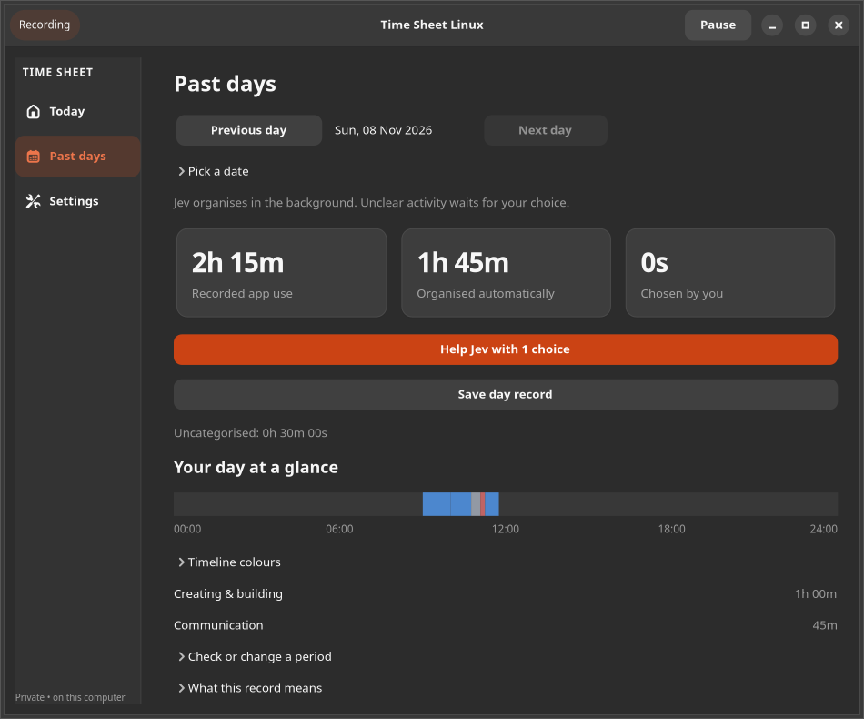

# Time Sheet Linux

A private Linux desktop app that records which applications you use, helps turn that activity into task time, and produces clear client timesheets. It runs in the background and keeps your activity, calendar and billing history on your computer.


## What it does

- Automatically records foreground app usage, with a live daily summary and app totals.
- Separates idle, locked, excluded and missing periods from active work.
- Starts at sign-in and keeps recording when the window closes; a user service restarts the collector after a crash.
- Shows a calendar, a 24-hour activity timeline and searchable task and desktop-usage history.
- Assigns usage to clients, projects and tasks, individually or in bulk. “Always assign this app” creates a reusable rule.
- Automatically turns settled rule matches into **draft** task entries. You review them before billing.
- Supports optional task timers, manual work, time budgets, split/merge, undo, bulk approval and a history of changes.
- Saves rates with approved entries and creates immutable CSV and printable HTML report snapshots.
- Locks billed entries and records invoice corrections without rewriting the original report.
- Provides daily local backups, checked restore, retention controls, app exclusions and period-specific activity deletion.

Window titles are **off by default**. No account, server, subscription, keystroke logging or screenshots are required. The screenshots in this repository contain synthetic example data.

## Linux compatibility

**Full automatic tracking currently targets GNOME Shell 50 on Wayland**, including Ubuntu 26.04. The included GNOME helper has been exercised in an isolated GNOME 50.1 Wayland session with a real foreground test window. Your current desktop needs a one-time sign-out/sign-in after installing the helper.

The interface requires Python 3.10 or newer, GTK 4 and libadwaita 1.5 or newer through the distribution's PyGObject packages. Manual timers and timesheets may work on other modern Linux desktops, but automatic capture adapters for KDE, other Wayland compositors and X11 are not included in this release. Do not assume universal Linux compatibility.

## Install on Ubuntu GNOME

Install the distribution packages:

```sh
sudo apt update
sudo apt install git python3-gi gir1.2-gtk-4.0 gir1.2-adw-1
```

Clone the repository into a folder you intend to keep:

```sh
git clone https://github.com/peternewing/timesheet-linux.git
cd timesheet-linux
./install.sh
```

Run the installer as your normal user, **not with sudo**. It installs a launcher, a command, a per-user background service and the local GNOME helper. It does not download Python packages or modify system-wide GNOME files.

Save your work and **sign out and back in once**. GNOME Wayland scans newly installed extensions at sign-in. The installer enables this app's helper while preserving your other extension settings. If GNOME globally disables user extensions, turn them on in the Extensions app.

Open **Time Sheet Linux** from Applications. The header should say **Tracking automatically**. A small clock icon in GNOME's top bar also opens the app and offers pause/resume. App names start appearing in Today without starting a task timer.

Keep the cloned folder in place: installed launchers and the service point to it. If you move the folder, run `./install.sh` again from its new location.

For detailed requirements, diagnostics, update and removal instructions, see [Installation and troubleshooting](docs/INSTALL.md).

## Daily workflow

1. **Let it record.** Check that Today says “Tracking automatically”. Pause any time, or pause for 15 minutes from Today. Capture is enabled by installation; title storage stays off unless you choose it.
2. **Create a project.** “New project” creates a client, project and first task together. Rates and time budgets are optional until billing.
3. **Assign work.** Choose “Assign usage” beside an app, or review a day in Calendar. Already assigned time is skipped. Tick “Always assign this application” when the whole app belongs to that task.
4. **Review.** In History, edit descriptions and billability, split or merge adjacent entries, and approve selected work. Recent automatic activity waits for the idle threshold before approval so idle detection cannot silently change billable time.
5. **Export.** Select a client and period in Reports. Create a saved snapshot, inspect it, then save CSV or a printable HTML report. Print the HTML from your browser to PDF if needed.
6. **Mark billed separately.** Enter your external invoice reference after invoicing. Repeated exports do not bill work twice. If you cancel or revise the external invoice, record the reason through the report's correction action; the original snapshot stays in history.

You can use a task timer for focused work or add a call, reading or offline work manually. Running timers, project and task totals, daily summaries and live activity counters update as each second is recorded. A running task is included in the assigned total; finished entries and saved reports stay fixed. Idle detection is an estimate: genuine reading and meetings can be recovered from away time. Foreground app usage alone does not prove that time is billable.

Mark unassigned personal activity as **Personal** to keep it in usage totals while clearing it from the work-assignment queue. You can return it to review later. History's **View** selector switches between task entries and retained desktop activity.



## Privacy and data

Data is stored under `~/.local/share/time-sheet-linux/` by default, following `XDG_DATA_HOME` when set. The main file is `timesheet.sqlite3`. Database and backup files use user-only permissions, but they are **not encrypted**.

- Detailed activity defaults to 30-day retention. Task entries and report history remain.
- Daily backups keep the latest seven local snapshots in `backups/`. Make an external backup as well if you need protection against disk loss.
- Settings can exclude application names before identifying details are stored, enable titles, change idle time and retention, or delete raw activity for a selected period.
- Deleting activity does not remove task entries, report exports, historical backups or filesystem remnants. Restoring an old backup may reintroduce deleted detail.
- The GNOME helper exposes foreground app/title and idle/lock data to processes in your user session. The app stores titles only when you enable that preference.
- The app makes no cloud or telemetry requests. GitHub access is not required to run it.

Do not upload your database or real activity screenshots to public issues. See [Privacy and security](SECURITY.md).

## Commands and shortcuts

```sh
./run-timesheet                 # Open the app
./run-timesheet --status        # Print recording health
./run-timesheet --pause         # Pause automatic capture
./run-timesheet --resume        # Resume capture
./run-timesheet --background    # Start the collector
./run-timesheet --install       # Repair desktop integration
./uninstall.sh                 # Remove integration; keep your data
```

Installation also creates `~/.local/bin/time-sheet-linux`. It is available as a command when that directory is on your PATH.

Keyboard shortcuts: **Ctrl+1** Today, **Ctrl+2** Calendar, **Ctrl+3** History, **Ctrl+N** new project, **Ctrl+Z** undo the last eligible edit, **Ctrl+R** refresh. Every timeline action also has a form/list equivalent.

## Current limits

This is an early desktop release. Exact-duration billing supports GBP, EUR and USD. It does not generate tax invoices, collect payments, sync devices, track browser URLs, provide team access or use AI. There is no direct PDF/XLSX export or configurable billing-duration rounding. App rules cannot distinguish clients inside a browser unless the user opts into an appropriate window-title rule.

Manual time input rejects nonexistent or repeated local clock times at daylight-saving transitions instead of guessing. Cross-midnight entries must be split if a report's date boundary cuts through them. Approved and billed amounts are snapshots; changing a default rate does not update old approved work.

The automated tests and isolated GNOME integration checks do not replace a real working-day trial on your own system. Accessibility, long-duration performance and additional Linux desktops need further validation. See [Testing and release evidence](docs/TESTING.md).

## Development

```sh
/usr/bin/python3 -m unittest discover -s tests -v
/usr/bin/python3 -m compileall -q timesheet
```

See [Contributing](CONTRIBUTING.md) and [Architecture](docs/ARCHITECTURE.md). Licensed under the [MIT License](LICENSE).
