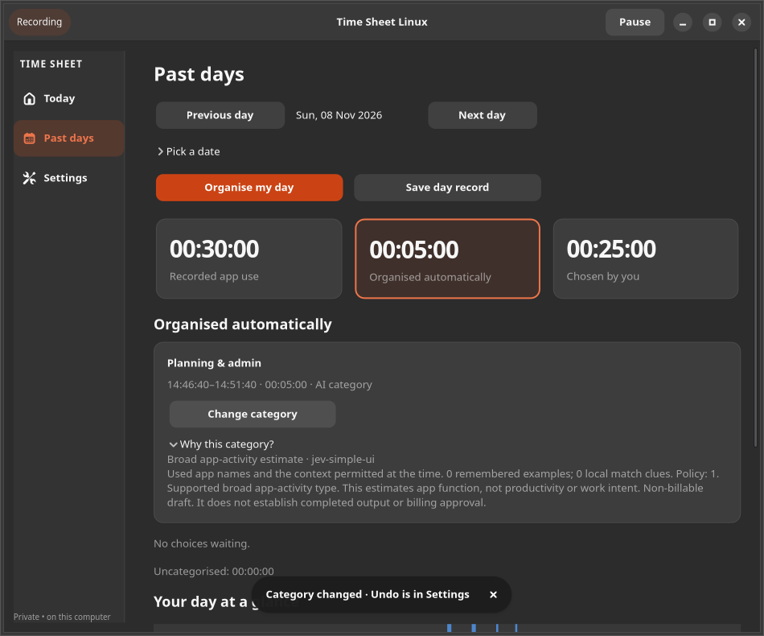

# Time Sheet Linux / Jev deep review

9 November 2026 · development checkout `timesheet-autopilot-0.5` · working tree, not an installed or published release

## Assessment

The implementation is substantially stronger than the original 0.4 baseline. Its main product limitation is still evidence: app-function classification is useful, but app duration does not establish client intent, productivity or completed output. Adding more questions or controls cannot manufacture missing context. Keep the simple day workflow and use optional business tools for deliberate project work.

Ratings below are engineering/product judgments of the current source and available validation. They combine implementation, usability and evidence maturity; they are not measured model accuracy, security certification or target scores. A 9–10 would need broader sustained and human acceptance than is available. Historical roadmap ratings remain intact.

Rubric: 0–2 absent/unsafe; 3–4 prototype; 5–6 material implementation or evidence gaps; 7–8 useful and tested with stated limits; 9–10 requires broad, sustained and representative acceptance. Half-points express judgment, not measurement precision.

There are **28 categories and exactly 84 concrete improvement examples**. Status counts: **48 implemented in this working iteration (including the immediately preceding setup work), 18 existing safeguards rechecked, 18 acceptance gates still open**. Several action IDs share an implementation; 48 does not mean 48 independent features. Existing safeguards are not presented as newly built features. Acceptance gates cannot honestly be marked complete from synthetic tests.

## Method and boundaries

Read the accepted roadmap and simplicity/daily-review guidance; inspected worker, policy, provider contract, context, memory, storage, capture, setup/day UI, evaluation, diagnostics, updates and CI. Reproduced defects with synthetic regression tests, then performed a fresh second pass. Only public documentation was browsed; no recorded user activity was sent, no real key accessed and no policy enabled in the user database. All test data uses disposable stores.

TypeSafe documents Jev as structured decisions over supplied state, with separate typed questions composed in application code. Its confidence is derived from the response distribution; it is not independent corroboration. These support the existing bounded classifier design, not a claim of real-work accuracy. Sources checked 9 November 2026: [Introduction](https://docs.typesafe.ai/introduction), [Confidence](https://docs.typesafe.ai/confidence). No new pricing or retention guarantee is asserted.

## Scorecard

| Category | Current /10 | Main remaining limit |
|---|---:|---|
| [Background Jev automation](#c01) | 8 | Continuous real-desktop and closed-window behaviour is not established. |
| [Context supplied to Jev](#c02) | 7 | App names cannot establish client identity or distinguish general browsing intent. |
| [Decision quality evidence](#c03) | 6 | Small synthetic samples do not establish representative daily precision. |
| [Automatic task assignment](#c04) | 8 | Routing thresholds remain heuristic and task-level live acceptance is incomplete. |
| [Uncertainty handling](#c05) | 8 | No representative calibration study supports the numeric thresholds. |
| [Learning from corrections](#c06) | 7.5 | A changed habit may still conflict with remembered history. |
| [Batch intelligence](#c07) | 8 | Large synthetic discovery is not a full-day throughput or resource guarantee. |
| [Proactive assistance](#c08) | 7.5 | No validated real-world alert or digest usefulness study exists. |
| [Daily workflow](#c09) | 8 | Measured novice completion and review effort remain unavailable. |
| [Rules/explanations](#c10) | 8 | Older entries still lack exact rule identity; novice understanding of rule scope is unverified. |
| [First-run onboarding](#c11) | 8 | Account/key acquisition and desktop setup still need real-user validation. |
| [Project/task setup](#c12) | 7.5 | Generic starters alone cannot distinguish similar client projects. |
| [Review burden](#c13) | 7.5 | Actual daily effort is not measured; remembered patterns may still repeat across days. |
| [Explanations/trust](#c14) | 8 | Explanation usefulness and historical policy reproducibility need more evidence. |
| [Correction/undo](#c15) | 8 | Remembered examples are intentionally separate from entry undo. |
| [Accessibility](#c16) | 6.5 | No human Orca acceptance or broad assistive-technology evidence exists. |
| [Activity recording](#c17) | 7.5 | Sustained physical desktop/suspend/disk-failure acceptance is incomplete. |
| [Time/billing integrity](#c18) | 8.5 | Final-package and real-use acceptance of billing/recovery safeguards remains open. |
| [Privacy controls](#c19) | 8 | Provider handling is external; backups retain data under their own lifecycle. |
| [API-key security](#c20) | 8 | Real keyring/portal/lock diversity is not fully established. |
| [Cost management](#c21) | 8 | The token cap can cross by one request and provider billing remains authoritative. |
| [Offline/API failures](#c22) | 8 | Prolonged live outage/recovery and provider retirement need acceptance. |
| [Performance](#c23) | 7.5 | One short synthetic run cannot establish week-long resource behaviour. |
| [Testing/evaluation](#c24) | 8.5 | Synthetic tests do not replace live or human acceptance. |
| [Linux compatibility](#c25) | 7 | Actual desktop/package coverage and closed-window Flatpak behaviour remain incomplete. |
| [Installation/updates](#c26) | 7.5 | This working tree is uncommitted and not a verified public release. |
| [Architecture](#c27) | 8 | The retained main GTK/store modules are still large. |
| [Auditability](#c28) | 8 | Retention intentionally prevents reconstruction of deleted private source detail. |

Unweighted mean: **7.71/10**. This is only an index of these judgments; weak decision-quality, accessibility and hardware evidence must not be averaged away.

## Defects found and fixed

1. Prior-day unknown charges could disappear from the send gate after midnight or a reset. Unknown usage now remains unresolved across all days until explicitly acknowledged. Daily totals have both calendar-day bounds.
2. Relevant corrections could be hidden by the newest 1,000 unrelated rows, and updated older examples were ordered by insertion ID. Retrieval now filters an indexed Unicode app/context key and sorts by correction time.
3. Forget removed examples without immediately invalidating dependent queued/in-flight work and cached results. It now does both; a late response cannot create an entry.
4. Repository schema construction used `executescript`, which can commit a caller transaction. Initialisation now preserves caller transactions and serialises migrations.
5. Persisted day-pass values were not fully validated. Malformed cursor/expiry/range/JSON now fails closed instead of crashing the worker.
6. Today could claim Jev was running without a current worker heartbeat. It now offers recovery and simple local usage details.
7. Automatic entries lacked a simple explanation; local-rule entries lacked the rule identity. Saved-model/policy explanations and minimal rule snapshots now supply factual history.
8. Export could subtract an omitted running timer from uncategorised totals. Snapshot coverage now uses only allocations included in that snapshot.
9. Undo had no action preview, and background activity could change which last action a user was about to revert. The new preview rechecks its ID under the write lock.
10. A malformed release-asset name could make a valid release undiscoverable. Invalid individual names are ignored safely.
11. Scaled UI review exposed More actions collapsing during a background refresh. Its expansion state is now retained.

## Detailed categories and three improvement examples each

### C01 — Background Jev automation — 8/10

**Working well:** Durable worker is independent of capture, with leases and standing consent.

**What limits the score:** Continuous real-desktop and closed-window behaviour is not established.

**Source evidence:** `automation_worker.py`, `automation_status.py`.

- **C01.1** **Detect a missing/stale worker and offer Restart Jev on Today.** — Implemented. Synthetic heartbeat, clock-jump and recovery tests; GTK recovery prompt.
- **C01.2** **Reject malformed, oversized or wrongly typed whole-day pass metadata.** — Implemented. Corrupt cursor, expiry, identity, range and JSON tests fail closed.
- **C01.3** **Run a 48-hour native/AppImage/Flatpak recovery trial including closed windows and login.** — Acceptance required. Record gaps, worker restarts and recovery latency per package/desktop.

### C02 — Context supplied to Jev — 7/10

**Working well:** Only permitted context is built; generic categories exclude private project names.

**What limits the score:** App names cannot establish client identity or distinguish general browsing intent.

**Source evidence:** `decision_context.py`, `decision_memory.py`.

- **C02.1** **Retrieve correction examples by Unicode-normalised app and exact clue/focus scope before limiting.** — Implemented. An older relevant example survives more than 1,000 unrelated corrections.
- **C02.2** **Offer ready-made task-guidance starters without adding a required setup field.** — Implemented. Optional unsaved starters in the existing task-guidance dialog.
- **C02.3** **Evaluate shared-browser/client-switch cases with explicitly consented, minimised context.** — Acceptance required. Compare time-weighted errors and coverage against app-only decisions.

### C03 — Decision quality evidence — 6/10

**Working well:** Recorded synthetic replays and full response validation exist.

**What limits the score:** Small synthetic samples do not establish representative daily precision.

**Source evidence:** `evaluate.py`, `decision_contract.py`.

- **C03.1** **Add stable case IDs, labelled-input fingerprints, slices and actual model metadata.** — Implemented. Replay output validates unique IDs and separates slice outcomes.
- **C03.2** **Compare saved candidate/reference responses on identical labelled inputs.** — Implemented. Changed inputs are refused; newly wrong automated cases and coverage deltas are reported.
- **C03.3** **Collect several independently labelled real days, sampling easy automatic cases as well as exceptions.** — Acceptance required. Keep private evidence outside the repository; report sample selection and wrong minutes.

### C04 — Automatic task assignment — 8/10

**Working well:** Assignments revalidate source evidence and preserve explicit choices; simple drafts are non-billable.

**What limits the score:** Routing thresholds remain heuristic and task-level live acceptance is incomplete.

**Source evidence:** `automation_store.py`, `daily_choices.py`.

- **C04.1** **Retain and exercise stale-response, concurrent-edit and explicit-choice protection.** — Existing safeguard rechecked. Core race/privacy tests and the independent worker-process check.
- **C04.2** **Retain rule precedence, no-gap allocation and draft-only AI execution.** — Existing safeguard rechecked. Core assignment, rule, undo and daily-choice regressions.
- **C04.3** **Measure cross-client wrong minutes before broadening task automation.** — Acceptance required. No financial approval or broader threshold based only on fixture success.

### C05 — Uncertainty handling — 8/10

**Working well:** None/ambiguous answers stay for review; generic and project risks have different gates.

**What limits the score:** No representative calibration study supports the numeric thresholds.

**Source evidence:** `decision_contract.py`, `decision_policy.py`, `automation_status.py`.

- **C05.1** **Use one reusable contract validator outside the worker lifecycle.** — Implemented. Worker, cache and evaluator import the same pure validation module.
- **C05.2** **Show the saved draft-policy reason and model beside automatic entries.** — Implemented. Inline Why this category? uses saved decision evidence, never a generated justification.
- **C05.3** **Calibrate abstention and errors separately for specialist apps, browsers and client projects.** — Acceptance required. Publish sample sizes and time-weighted error/coverage curves before changing gates.

### C06 — Learning from corrections — 7.5/10

**Working well:** Corrections are scoped local examples, not a claim of model retraining.

**What limits the score:** A changed habit may still conflict with remembered history.

**Source evidence:** `decision_memory.py`, `decision_context.py`.

- **C06.1** **Index app/scope retrieval so unrelated history cannot hide relevant examples.** — Implemented. Unicode and >1,000 unrelated-row regression; bounded eight-example lookup.
- **C06.2** **Order updated corrections by correction time rather than original row ID.** — Implemented. Updating an older correction makes it the first relevant example.
- **C06.3** **Clear cached decisions and invalidate queued/in-flight jobs when examples are forgotten.** — Implemented. A response arriving after Forget cannot create an entry.

### C07 — Batch intelligence — 8/10

**Working well:** Equivalent payloads reuse durable results; one choice covers an app/day.

**What limits the score:** Large synthetic discovery is not a full-day throughput or resource guarantee.

**Source evidence:** `day_organiser.py`, `automation_worker.py`, `benchmark.py`.

- **C07.1** **Recheck equivalent clear and ambiguous requests are reused without extra key access.** — Existing safeguard rechecked. Whole-day/cache tests preserve request and consent limits.
- **C07.2** **Make priority-pass persistence robust to malformed and superseded metadata.** — Implemented. Invalid state cannot crash the loop or replace a newer pass.
- **C07.3** **Add a repeatable disposable large-history benchmark.** — Implemented. 20,000 observations, 20 tasks, five bounded discovery batches recorded locally.

### C08 — Proactive assistance — 7.5/10

**Working well:** Today exposes missing workers; local counts distinguish queued, uncertain and failed work.

**What limits the score:** No validated real-world alert or digest usefulness study exists.

**Source evidence:** `automation_status.py`, `simple_ui.py`, `day_record.py`.

- **C08.1** **Expose an actionable missing-worker warning instead of a false working claim.** — Implemented. Stale/future/corrupt heartbeats and UI recovery tested.
- **C08.2** **Expose factual background usage, limits and unresolved charges in simple Settings.** — Implemented. Collapsed local details require no key access or data transmission.
- **C08.3** **Provide a factual local day digest using observed totals and covered intervals.** — Implemented. Existing record-help expander now summarises recorded, covered, uncategorised and gap time.

### C09 — Daily workflow — 8/10

**Working well:** Three destinations, one app/day choice, live cards and optional tools are coherent.

**What limits the score:** Measured novice completion and review effort remain unavailable.

**Source evidence:** `simple_ui.py`, `daily_choices.py`.

- **C09.1** **Retain one daily choice with future same-day reuse and protected existing entries.** — Existing safeguard rechecked. Daily-choice and UI tests cover separated periods and direct Assign.
- **C09.2** **Keep optional day actions expanded through background refreshes.** — Implemented. Found during scaled UI review; More actions now retains its expansion state.
- **C09.3** **Observe setup-to-saved-day completion and count clicks/repeated questions.** — Acceptance required. Record task completion, errors and median review minutes with consenting users.

### C10 — Rules/explanations — 8/10

**Working well:** Rules are local, previewable and conservative around conflicting priorities.

**What limits the score:** Older entries still lack exact rule identity; novice understanding of rule scope is unverified.

**Source evidence:** `store.py`, `rules.py`, `automation_status.py`.

- **C10.1** **Save rule identity, priority and title-condition flag when a rule allocates time.** — Implemented. Rule explanation survives later rule deletion without duplicating raw title content.
- **C10.2** **Retain duplicate/conflict/archive/title-availability warnings and previews.** — Existing safeguard rechecked. Existing rule core/GTK regressions rechecked.
- **C10.3** **Test whether novices understand rule scope and future versus historical effects.** — Acceptance required. Observe a rule creation, deliberate conflict and correction without coaching.

### C11 — First-run onboarding — 8/10

**Working well:** Four click-only steps keep projects, rates and rules optional.

**What limits the score:** Account/key acquisition and desktop setup still need real-user validation.

**Source evidence:** `setup_ui.py`, `simple_setup.py`.

- **C11.1** **Integrate optional purpose-based project/rule/report shortcuts in the existing fourth step.** — Implemented. Choices stay staged until Start and appear in day actions.
- **C11.2** **Preserve app exclusions and custom request/token limits when reconnecting.** — Implemented. Excluded eligible activity remains unsent; final disclosure shows saved limits.
- **C11.3** **Test saved-key, pasted-key, locked-keyring and local-only first runs with novices.** — Acceptance required. Measure completion and comprehension of the Start consent boundary.

### C12 — Project/task setup — 7.5/10

**Working well:** Task guidance and overlapping-definition warnings already exist.

**What limits the score:** Generic starters alone cannot distinguish similar client projects.

**Source evidence:** `automation_ui.py`, `automation_store.py`.

- **C12.1** **Offer optional short activity-type starter descriptions.** — Implemented. Choosing a starter only fills the unsaved guidance field.
- **C12.2** **Retain overlap warnings and explicit bounded focus context.** — Existing safeguard rechecked. Profile and focus-boundary regressions; no focus creates time on its own.
- **C12.3** **Validate competing real project definitions and revise descriptions based on observed confusion.** — Acceptance required. Use paired shared-app examples; require fewer wrong client minutes, not just more coverage.

### C13 — Review burden — 7.5/10

**Working well:** App/day grouping avoids repeated per-observation decisions.

**What limits the score:** Actual daily effort is not measured; remembered patterns may still repeat across days.

**Source evidence:** `simple_store.py`, `daily_choices.py`, `automation_status.py`.

- **C13.1** **Keep one local answer for separated and later same-day periods.** — Existing safeguard rechecked. Grouping, continuation, undo and stale-human-choice tests.
- **C13.2** **Make operational state/usage visible without opening the advanced automation form.** — Implemented. Collapsed simple Settings details and recovery action.
- **C13.3** **Measure repeated corrections and review time over at least five consenting-user days.** — Acceptance required. Separate unresolved, excluded and wrongly allocated minutes; do not optimise only coverage.

### C14 — Explanations/trust — 8/10

**Working well:** Automatic entries now expose saved model, context counts and policy reasons.

**What limits the score:** Explanation usefulness and historical policy reproducibility need more evidence.

**Source evidence:** `automation_status.py`, `automation_store.py`.

- **C14.1** **Provide inline Why this category? for AI and local-rule entries.** — Implemented. Templates use saved evidence and clearly state missing historical detail.
- **C14.2** **Persist an explicit routing version for new decisions; mark old versions unknown.** — Implemented. Additive migration defaults to zero, not an invented historical version.
- **C14.3** **State that workflow counts and model scores do not prove accuracy, output or billing approval.** — Implemented. Simple/advanced usage wording and explanations preserve these distinctions.

### C15 — Correction/undo — 8/10

**Working well:** Edits remain reversible drafts and billed work stays protected.

**What limits the score:** Remembered examples are intentionally separate from entry undo.

**Source evidence:** `store.py`, `simple_ui.py`, `decision_memory.py`.

- **C15.1** **Preview the actual last action and guard Undo against newer background changes.** — Implemented. Expected change ID is rechecked under the write lock.
- **C15.2** **Make repository schema checks preserve the caller transaction.** — Implemented. A deliberately rolled-back caller write remains rolled back after Repository construction.
- **C15.3** **Test correction, Forget and Undo comprehension with real users.** — Acceptance required. Users must distinguish reverting time from forgetting examples without extra manual setup.

### C16 — Accessibility — 6.5/10

**Working well:** Native buttons/expanders, accessible card labels and scaling checks provide a base.

**What limits the score:** No human Orca acceptance or broad assistive-technology evidence exists.

**Source evidence:** `simple_ui.py`, `setup_ui.py`, `tests/verify_simple_ui.py`.

- **C16.1** **Retain actual mouse/keyboard checks and accessible Assign/card names.** — Existing safeguard rechecked. Existing workflows exercise native controls and focus.
- **C16.2** **Check the changed default flow at normal and 200% scale.** — Existing safeguard rechecked. Isolated GTK checks and actual rendered screenshots, not a screen-reader claim.
- **C16.3** **Run human Orca, keyboard-only and large-text acceptance for setup/review/undo/export.** — Acceptance required. Record focus order, announced labels, errors and successful task completion.

### C17 — Activity recording — 7.5/10

**Working well:** Capture is independent, records gaps and does not wait for Jev requests.

**What limits the score:** Sustained physical desktop/suspend/disk-failure acceptance is incomplete.

**Source evidence:** `collector.py`, `capture.py`, `tests/verify_worker_process.py`.

- **C17.1** **Recheck concurrent recording writes during a delayed decision process.** — Existing safeguard rechecked. Separate process test verifies durable draft and DB integrity.
- **C17.2** **Retain explicit away, locked, personal, excluded and unknown intervals.** — Existing safeguard rechecked. Capture/privacy tests and factual day-record tests.
- **C17.3** **Run multi-day suspend/resume, lock/login and disk-exhaustion tests on disposable hardware data.** — Acceptance required. Compare captured intervals with a reference log; never fill missing time by inference.

### C18 — Time/billing integrity — 8.5/10

**Working well:** Overlap/rate snapshots and draft/billed boundaries are extensively tested.

**What limits the score:** Final-package and real-use acceptance of billing/recovery safeguards remains open.

**Source evidence:** `store.py`, `day_record.py`, `daily_choices.py`.

- **C18.1** **Fix exports subtracting a timer that the export omitted.** — Implemented. The same synthetic day is checked with and without an included running timer.
- **C18.2** **Make migration checks and Undo concurrency-safe without committing partial changes.** — Implemented. Caller rollback and expected-change regressions.
- **C18.3** **Recheck non-billable generic AI, protected billing and stale-assignment gates.** — Existing safeguard rechecked. Core store, daily-choice, PDF and advanced workflow regressions.

### C19 — Privacy controls — 8/10

**Working well:** Consent, exclusions, generic-only context and local title reduction are explicit.

**What limits the score:** Provider handling is external; backups retain data under their own lifecycle.

**Source evidence:** `decision_context.py`, `automation_store.py`, `simple_setup.py`.

- **C19.1** **Make Forget stop dependent pending/in-flight work and remove cached decisions.** — Implemented. Late completion cannot apply a forgotten-context decision.
- **C19.2** **Retain existing exclusions and sending caps when simple setup is repeated.** — Implemented. Regression proves an eligible excluded app generates no provider request.
- **C19.3** **Recheck exports/status/explanations omit raw titles, paths, descriptions and secrets.** — Existing safeguard rechecked. Synthetic privacy tests plus source review; permitted local project names remain intentional.

### C20 — API-key security — 8/10

**Working well:** Keys use secure storage; errors are sanitised and unlock failures pause quietly.

**What limits the score:** Real keyring/portal/lock diversity is not fully established.

**Source evidence:** `jev.py`, `automation_worker.py`, `packaging/verify_secret_portal.py`.

- **C20.1** **Retain no repeated unlock attempts while the worker is paused.** — Existing safeguard rechecked. Key-error regression verifies a single key access and no usage reservation.
- **C20.2** **Keep new status/explanations/replay/benchmark features independent of key access.** — Implemented. New tools run locally with synthetic data; no real key is read.
- **C20.3** **Exercise encrypted secret portal and missing-portal behaviour using a private fake service.** — Existing safeguard rechecked. Private synthetic portal check; physical desktop unlock acceptance remains separate.

### C21 — Cost management — 8/10

**Working well:** Strict request caps, reported tokens and cache reuse exist.

**What limits the score:** The token cap can cross by one request and provider billing remains authoritative.

**Source evidence:** `automation_store.py`, `automation_status.py`.

- **C21.1** **Keep unresolved usage blocking across midnight, Resume and policy reconfiguration.** — Implemented. A prior-day unknown charge prevents a new request until acknowledged.
- **C21.2** **Bound daily totals to the actual local calendar day.** — Implemented. Other-day ledger rows cannot distort today's usage totals.
- **C21.3** **Show request/token limits and unresolved usage across all days in simple Settings.** — Implemented. Factual counts only; no invented currency cost or token estimate.

### C22 — Offline/API failures — 8/10

**Working well:** Queue/backoff/lease handling preserve capture and avoid blind charged retries.

**What limits the score:** Prolonged live outage/recovery and provider retirement need acceptance.

**Source evidence:** `automation_worker.py`, `day_organiser.py`.

- **C22.1** **Fail closed on corrupt persisted day-pass JSON/types.** — Implemented. Malformed expiry/cursor/identity and oversized/deep JSON tests.
- **C22.2** **Retain bounded retry and unknown-spend acknowledgement semantics.** — Existing safeguard rechecked. Provider rejection, timeout, abandoned lease and budget tests.
- **C22.3** **Run controlled real-provider outage/auth/model-retirement recovery tests with synthetic prompts.** — Acceptance required. Record requests/usage/recovery; do not send recorded work or retry unknown charges silently.

### C23 — Performance — 7.5/10

**Working well:** Discovery and UI work are bounded; relevant-example lookup is indexed.

**What limits the score:** One short synthetic run cannot establish week-long resource behaviour.

**Source evidence:** `decision_memory.py`, `benchmark.py`, `day_record.py`.

- **C23.1** **Index relevant correction lookup and order by correction time.** — Implemented. App/scope/at index plus large unrelated-history regression.
- **C23.2** **Provide repeatable bounded discovery timing and RSS evidence.** — Implemented. Disposable synthetic DB; no flaky pass/fail timing threshold.
- **C23.3** **Run a week-long CPU/RSS/IO/storage profile across realistic retention sizes.** — Acceptance required. Record machine/package/desktop and latency distributions; set budgets from observations.

### C24 — Testing/evaluation — 8.5/10

**Working well:** Broad deterministic tests now include the newly found failures.

**What limits the score:** Synthetic tests do not replace live or human acceptance.

**Source evidence:** `tests/test_deep_review.py`, `evaluate.py`, `.github/workflows/tests.yml`.

- **C24.1** **Add adversarial regressions for midnight usage, memory, schema rollback, status, exports and Undo.** — Implemented. New cases reproduce the defects and verify their corrected behaviour.
- **C24.2** **Add immutable-input offline response comparison and per-slice replay evidence.** — Implemented. Case identity changes are refused; wrong automatic decisions are enumerated.
- **C24.3** **Run the synthetic discovery benchmark in CI without a machine-specific speed gate.** — Implemented. CI benchmark command added for both existing core OS jobs; final-commit CI execution remains a release gate.

### C25 — Linux compatibility — 7/10

**Working well:** Multiple adapter protocols and virtual X11 paths have checks.

**What limits the score:** Actual desktop/package coverage and closed-window Flatpak behaviour remain incomplete.

**Source evidence:** `capture.py`, `desktop.py`, `tests/verify_*`.

- **C25.1** **Recheck virtual X11 capture on an isolated display.** — Existing safeguard rechecked. Synthetic virtual display is protocol evidence, not hardware acceptance.
- **C25.2** **Recheck GNOME and KDE fake-service protocols and privacy boundaries.** — Existing safeguard rechecked. Private DBus test services; no real user activity is sent.
- **C25.3** **Complete a physical GNOME/KDE/Sway/Hyprland and native/AppImage/Flatpak matrix.** — Acceptance required. Record versions, GPU, permissions, background behaviour and exact failures.

### C26 — Installation/updates — 7.5/10

**Working well:** Updates remain read-only and packaging has source/provenance gates.

**What limits the score:** This working tree is uncommitted and not a verified public release.

**Source evidence:** `updates.py`, `packaging/verify_release.py`, `.github/workflows`.

- **C26.1** **Ignore malformed individual asset names without hiding an otherwise valid release.** — Implemented. A structured invalid name plus valid assets still yields the verified release link.
- **C26.2** **Validate fresh install, compatible upgrade, backup restore and rollback for final packages.** — Acceptance required. Use disposable databases and preserve consent, records and key ownership.
- **C26.3** **Build trusted final-source packages, verify provenance/hashes and publish only those artifacts.** — Acceptance required. CI/source SHA/public asset digests/local installation must match before claiming delivery.

### C27 — Architecture — 8/10

**Working well:** Policy, memory, validation, status and setup now have clearer boundaries.

**What limits the score:** The retained main GTK/store modules are still large.

**Source evidence:** `decision_contract.py`, `decision_memory.py`, `automation_status.py`, `setup_ui.py`.

- **C27.1** **Extract response validation so evaluation does not depend on worker lifecycle.** — Implemented. Worker and evaluator share the same standalone contract function.
- **C27.2** **Extract scoped memory and local operational explanations/status.** — Implemented. New modules have direct regression coverage and no key/network requirement.
- **C27.3** **Extract four-step setup from daily rendering/review.** — Implemented. SetupUI mixin retains the same public UI behaviour and four steps.

### C28 — Auditability — 8/10

**Working well:** Typed results, source fingerprints, ledger and edits are durable.

**What limits the score:** Retention intentionally prevents reconstruction of deleted private source detail.

**Source evidence:** `automation_store.py`, `automation_status.py`, `docs/evidence`.

- **C28.1** **Persist routing version on new decisions and show historical unknowns honestly.** — Implemented. Version zero is unknown; source-deleted decisions do not gain fabricated explanations.
- **C28.2** **Retain local rule identities without copying raw title evidence.** — Implemented. Rule snapshots survive rule deletion while containing only ID/priority/condition type.
- **C28.3** **Publish an 84-item machine-readable register with ratings, evidence and acceptance gates.** — Implemented. This report, plan and JSON share the same 28 categories and three actions each.

## Implemented interface example

Actual GTK rendering with synthetic records and a fake provider; no user activity is shown.

## Validation and second-pass record

263 core regressions passed; 81 default-flow GTK checks passed at both normal and 200% scale; 53 retained advanced GUI checks and 23 automation UI checks passed. Separate worker/concurrent-recording, private synthetic Secret portal, GNOME/KDE fake-service and virtual X11 capture checks passed. Python compilation, launcher shell syntax and whitespace checks passed. Public CI and final package delivery were not performed.

The disposable benchmark used 20,000 observations and 20 tasks. Five 100-row discovery batches took **0.0191–0.0214 seconds**; peak process RSS was **30,080 KiB** on Python 3.14.4. This is a short synthetic smoke measurement, not sustained desktop performance.

| Offline labelled replay | Cases | Automatically eligible | Wrong synthetic automated minutes |
|---|---:|---:|---:|
| Broad app categories | 8 | 5 | 0 |
| Strict project/focus fixtures | 8 | 4 | 0 |

These replay previously recorded synthetic answers. No live inference occurred in this review; zero wrong fixture minutes does not establish real-work accuracy. Source fingerprint: `864be13a2044f8add450d72243de698266fe6c403e5a36c95587381e2d9c547e`. Its scope is defined in the ledger; it is not a signed package provenance claim.

The final run details and source fingerprint are recorded in [the validation ledger](evidence/deep-review-validation-2026-11-09.json). Replays and the short benchmark are saved under `docs/evidence/`. Their evidence labels explicitly distinguish offline replay and synthetic performance from real use.

The second pass checked data/consent boundaries, cross-midnight accounting, Unicode migration, retention, in-flight response races, undo races, omitted timers and UI refresh behaviour. It also caught that routing policy needs its own version, separate from sending consent; historical rows remain unknown rather than being backfilled with an invented policy.

No target threshold was relaxed, no claim of trained/personalised model weights was introduced, and no new background transmission was enabled. Real-day precision, novice comprehension, Orca acceptance, physical desktop/package coverage, trusted CI and final delivery remain open.

## What to do next

See [the executable improvement and acceptance plan](IMPROVEMENT_PLAN_2026-11-09.md). It names the remaining gates, order, evidence and completion conditions. Re-score only when the corresponding evidence changes; do not raise scores merely because code or a checklist exists.
