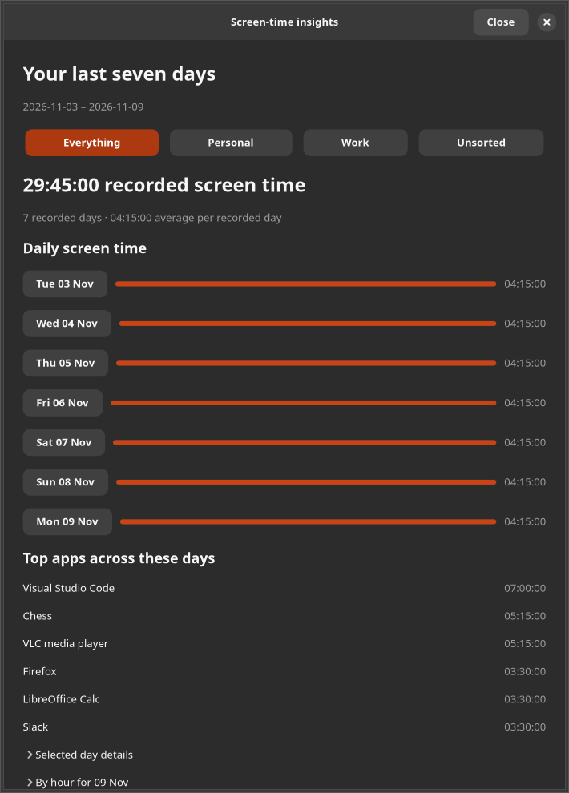
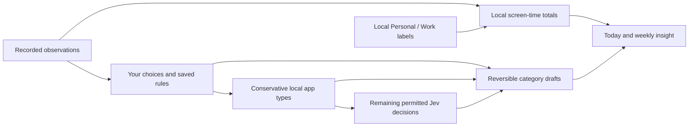

# Personal and work screen-time reassessment

9 November 2026 · active `timesheet-autopilot-0.5` development checkout · **completed local iteration; external acceptance remains open**

## What the app now does

The product now treats all computer screen time as useful evidence. Games, media, browsing and utilities sit alongside creating, learning, communication and planning. Personal use is legitimate use. The app separates observed time, activity type, local Personal/Work context and financial entries.

Jev is a typed decision service over deliberately supplied evidence. The app validates its complete result and applies a conservative draft policy. It does not independently observe your computer, establish productivity or prove which client a browser tab belongs to. Clear installed app functions can now be labelled locally before a paid request; Jev handles remaining permitted decisions. Screen-time statistics work with no key or network.

Today, Past days and Settings remain the default destinations. Setup still has four click-only steps. Optional spaces and ready-made schedules add personal/work context without creating a timer, widening outgoing context or approving financial time. Hourly corrections and Undo preserve original captured observations.

## Assessment method

This extends, rather than replaces, the [earlier report](DEEP_REVIEW_2026-11-09.md), [84-action plan](IMPROVEMENT_PLAN_2026-11-09.md) and [accepted roadmap](AUTOMATION_ROADMAP.md). There are three concrete scoped improvements/checks for each of 28 categories, followed by a fresh second-pass refinement. Shared implementations appear in several categories; this is not a claim of 84 independent new features. Existing safeguards are described as retained/rechecked where applicable.

Ratings are engineering/product judgments based on implemented capability and evidence maturity, not percentages, calibrated model accuracy or a security/accessibility certification. The prior rubric is retained: useful tested systems with stated limits sit around 7–8; 9–10 needs broader representative, sustained and human acceptance. Three prior high/security scores are deliberately retained rather than inflated. The machine register marks 64 new/refined implementation entries, eight retained protections and 12 new validation/evidence entries separately. Shared work means these are not 64 independent features. All 18 previous external acceptance gates remain open; a two-hour synthetic process cannot replace a 48-hour or week-long real-desktop trial.

Actual work started at 18:44 UTC. The [work log](PERSONAL_WORK_ITERATION.md) records implementation, second-pass findings and test timing. Shared work is not assigned invented five-minute category blocks. Sustained processes retain the source hashes loaded at their start; later changes do not retroactively become covered by an earlier process.

## Evidence already established

- 328 unit/regression tests, including interval privacy/overlap, 23/25-hour DST days, local inference, transaction rollback, scoped memory, read-only templates and stale-response races.
- 93 native simple-UI checks at normal and 200% scale, 53 retained advanced GUI checks and 26 automation UI checks. The host-built AppDir also passed the 93-check 200% simple flow. A further 15 native checks exercise delayed read responsiveness, Close cancellation, stale filters, native selected state and matching-preview export. Final source-matched bundle reruns are tracked by the validation ledger.
- Exactly 20 explicitly approved public synthetic TypeSafe requests, all completed, model `jev-1.14.0`, 21,054 reported input tokens. All 20 selected the labelled synthetic option; 16 routed to automatic drafts and four to exceptions. Two were browser choices with low sufficient-evidence scores; thresholds were not relaxed. Synthetic time coverage was 80% with zero wrong automated synthetic minutes. These figures do not estimate real-day precision or coverage. No recorded user activity or private project data was sent. The saved key was accessed only for this separately authorised live run; the 20-request approval is exhausted and no further paid requests were made.
- A like-for-like fixed-time 200,000-observation benchmark reduced median weekly summary time from 0.940 to 0.622 seconds (~34%). The first exploratory fixture left a recent-day gap; it was corrected and excluded from the final comparison. Both final runs use the same fixture time and generator. These are host timings, not universal latency promises.
- Private synthetic Secret-portal storage, collector privacy/idle, KDE owner/heartbeat protocol, separate worker process, actual isolated GNOME extension/window and private X11 property/idle checks passed. KDE's compositor was simulated; GNOME and X11 were headless/virtual, not physical hardware acceptance.
- The synthetic two-page PDF was rendered and visually checked. Private app names and titles remain absent; screen, private, away/gap, activity-type and Personal/Work totals are distinct. Local CSV exports are formula-safe and private file writes are covered.
- Sustained core and corrected native UI runs completed with no invariant/read failures. Their durations and source scopes are recorded below; the earlier two-hour core run is not presented as a whole-final-tree test.

Local desktop metadata uses standard declared categories and exact registered identities. Broad or conflicting metadata abstains; general Viewer metadata is not treated as proof of learning. Primary references: [Freedesktop main categories](https://specifications.freedesktop.org/menu/latest/category-registry.html), [additional categories](https://specifications.freedesktop.org/menu/latest/additional-category-registry.html), [desktop entry keys](https://specifications.freedesktop.org/desktop-entry/latest/recognized-keys.html). Metadata is read locally; Exec is never launched for classification.

A separate one-million-observation stress fixture took a median 3.479s per week and about 345 MiB peak process RSS. This is a useful limit, not a speed success. The insight UI now performs that work on a separate query-only connection, keeps GTK responsive, cancels closed windows, discards older filter results and disables export until its matching preview is ready. Statistics read no titles; returned UI values omit full interval copies. The first native refresh/reopen run exposed a retained rendered-window callback cycle. The fix removes closed controls and their timer/controller references. The focused regression now collects all 20 rapidly reopened windows; the fresh 30-minute native run completed, including scheduled reopen/GC checks.

SQLite page-quota failures also exercise rollback and recovery of schedules, local category drafts, cursors and Undo. These disposable checks do not close the physical disk-exhaustion gate.

The capture tuple currently supplies foreground identity, idle time and lock state. If the desktop reports idle, capture records away even for a player or reading app. Playback/display-power evidence is not collected. This is an observed activity estimate, not a validated phone-equivalent screen-on total. Real-desktop acceptance must include long passive reading, foreground video, paused playback, background audio and unattended unlocked screens; TypeSafe cannot reconstruct evidence that was never captured.

## Scorecard

| Category | Previous /10 | Reassessment /10 |
|---|---:|---:|
| [Background Jev automation](#c01) | 8 | 8.5 |
| [Context supplied to Jev](#c02) | 7 | 7.5 |
| [Decision quality evidence](#c03) | 6 | 7 |
| [Automatic task assignment](#c04) | 8 | 8.5 |
| [Uncertainty handling](#c05) | 8 | 8.5 |
| [Learning from corrections](#c06) | 7.5 | 8 |
| [Batch intelligence](#c07) | 8 | 8.5 |
| [Proactive assistance](#c08) | 7.5 | 8 |
| [Daily workflow](#c09) | 8 | 8.5 |
| [Rules/explanations](#c10) | 8 | 8.5 |
| [First-run onboarding](#c11) | 8 | 8.5 |
| [Project/task setup](#c12) | 7.5 | 8 |
| [Review burden](#c13) | 7.5 | 8 |
| [Explanations/trust](#c14) | 8 | 8.5 |
| [Correction/undo](#c15) | 8 | 8.5 |
| [Accessibility](#c16) | 6.5 | 7 |
| [Activity recording](#c17) | 7.5 | 8 |
| [Time/billing integrity](#c18) | 8.5 | 8.5 |
| [Privacy controls](#c19) | 8 | 8.5 |
| [API-key security](#c20) | 8 | 8 |
| [Cost management](#c21) | 8 | 8.5 |
| [Offline/API failures](#c22) | 8 | 8.5 |
| [Performance](#c23) | 7.5 | 8 |
| [Testing/evaluation](#c24) | 8.5 | 8.5 |
| [Linux compatibility](#c25) | 7 | 7.5 |
| [Installation/updates](#c26) | 7.5 | 8 |
| [Architecture](#c27) | 8 | 8.5 |
| [Auditability](#c28) | 8 | 8.5 |

Mean judgment: 7.71 → 8.18/10. Capability gains are larger than the score movement because unverified human, real-day and physical-desktop evidence still limits the ratings. Local validation is complete; the stated external acceptance limits still constrain these judgments.

## Category review and second pass

### C01 · Background Jev automation — 8 → 8.5/10

1. Run local installed-app classification alongside saved choices and rules, even with Jev off.
2. Keep capture independent while a separate worker organises permitted completed observations.
3. Exercise collector, worker and screen summaries together in sustained disposable runs.

Second pass: Reject corrupt retry timing before key access and require a deliberate Resume.

Evidence: [timesheet/local_types.py](../timesheet/local_types.py), [timesheet/automation_worker.py](../timesheet/automation_worker.py), [tests/soak_screen_time.py](../tests/soak_screen_time.py).

Remaining: Native/AppImage/Flatpak 48-hour login, closed-window and recovery acceptance remains open.

### C02 · Context supplied to Jev — 7 → 7.5/10

1. Offer eight explicit app-function definitions, including browsing, games, media and utilities.
2. Keep Personal/Work context local and separate from outgoing project/task evidence.
3. Exclude private, changed or missing source observations from remembered context.

Second pass: Treat one fragmented app/day correction as one relevant example rather than many votes.

Evidence: [timesheet/simple_setup.py](../timesheet/simple_setup.py), [timesheet/decision_memory.py](../timesheet/decision_memory.py), [tests/test_screen_safety.py](../tests/test_screen_safety.py).

Remaining: Shared-browser client intent still needs permitted distinguishing evidence and a labelled real-work evaluation.

### C03 · Decision quality evidence — 6 → 7/10

1. Collect exactly the 20 separately approved public synthetic TypeSafe answers.
2. Record actual model, token use, per-slice choices, exceptions and time-weighted sample coverage.
3. Add a read-only private template builder for later independent manual labelling.

Second pass: Reject unlabelled templates before key lookup or any paid evaluation request.

Evidence: [docs/evidence/personal-work-live-synthetic-2026-11-09.json](../docs/evidence/personal-work-live-synthetic-2026-11-09.json), [timesheet/evaluation_template.py](../timesheet/evaluation_template.py), [tests/test_evaluation_safety.py](../tests/test_evaluation_safety.py).

Remaining: Public synthetic cases are not representative real-day accuracy; independently labelled easy and uncertain real cases remain required.

### C04 · Automatic task assignment — 8 → 8.5/10

1. Create reversible non-billable drafts from conservative local app metadata.
2. Respect saved daily choices, skip choices, rules, protected entries and active timers before local allocation.
3. Guard local allocation against privacy, task or source changes under a write transaction.

Second pass: Test local allocation winning while an AI response is in flight: one saved interval and accounted usage.

Evidence: [timesheet/local_types.py](../timesheet/local_types.py), [timesheet/daily_choices.py](../timesheet/daily_choices.py), [tests/test_local_types.py](../tests/test_local_types.py).

Remaining: Client/project wrong-minute measurement remains open; generic activity labels do not establish client intent.

### C05 · Uncertainty handling — 8 → 8.5/10

1. Abstain on broad or contradictory installed categories instead of guessing intent.
2. Preserve conservative TypeSafe routing: both browser examples stayed exceptions despite correct top choices.
3. Represent missing or conflicting foreground evidence as gaps, independently of category uncertainty.

Second pass: Include unknown desktop identities in collision checks; remove generic Viewer-to-learning inference.

Evidence: [timesheet/local_types.py](../timesheet/local_types.py), [timesheet/screen_time.py](../timesheet/screen_time.py), [docs/evidence/personal-work-live-synthetic-2026-11-09.json](../docs/evidence/personal-work-live-synthetic-2026-11-09.json).

Remaining: Abstention thresholds still need representative calibration across real applications and client projects.

### C06 · Learning from corrections — 7.5 → 8/10

1. Retrieve only live active-source examples in the exact permitted app/context scope.
2. Deduplicate fragmented same-day memories before selecting eight recent examples.
3. Expose a click-only Forget corrections for one app action without deleting activity or entries.

Second pass: Check Unicode-scoped Forget clears dependent cache/jobs while retaining unrelated examples and saved time.

Evidence: [timesheet/decision_memory.py](../timesheet/decision_memory.py), [timesheet/automation_ui.py](../timesheet/automation_ui.py), [tests/test_evaluation_safety.py](../tests/test_evaluation_safety.py).

Remaining: Correction habits and Forget/Undo comprehension need consenting-user observation.

### C07 · Batch intelligence — 8 → 8.5/10

1. Process clear local app types before spending a provider request.
2. Version cache identities and durable jobs by the local request contract.
3. Record a 200,000-observation, 20-batch bounded discovery benchmark.

Second pass: Retain validated provider/cache provenance so reuse does not look like a new request.

Evidence: [timesheet/automation_worker.py](../timesheet/automation_worker.py), [timesheet/automation_store.py](../timesheet/automation_store.py), [docs/evidence/personal-work-discovery-benchmark-2026-11-09.json](../docs/evidence/personal-work-discovery-benchmark-2026-11-09.json).

Remaining: A bounded benchmark does not establish full-day throughput on every package or machine.

### C08 · Proactive assistance — 7.5 → 8/10

1. Provide optional automatic Personal/Work schedule labels using three ready-made choices.
2. Refresh weekly insights when labels change or a 30-second interval passes.
3. Add read-only aggregate database health for capture age, integrity and unknown usage.

Second pass: Treat future collector heartbeats as unavailable evidence instead of healthy capture.

Evidence: [timesheet/screen_spaces.py](../timesheet/screen_spaces.py), [timesheet/screen_ui.py](../timesheet/screen_ui.py), [timesheet/diagnostics.py](../timesheet/diagnostics.py).

Remaining: Schedule expectations are user intent labels, not inferred behaviour; real digest usefulness remains unmeasured.

### C09 · Daily workflow — 8 → 8.5/10

1. Add seven-day totals, top apps, daily bars and hourly observed use to the existing day flow.
2. Provide Everything, Personal, Work and Unsorted filters without project setup.
3. Open a selected day directly from its weekly bar and save its local summary.

Second pass: Use compact app rankings and preserve expansion, scroll and focus across insight refreshes.

Evidence: [timesheet/screen_ui.py](../timesheet/screen_ui.py), [tests/verify_simple_ui.py](../tests/verify_simple_ui.py), [docs/screenshots/screen-time-development.png](../docs/screenshots/screen-time-development.png).

Remaining: Novice setup-to-saved-day timing and completion observation remain open.

### C10 · Rules/explanations — 8 → 8.5/10

1. Keep explicit saved rules ahead of local metadata and Jev decisions.
2. Save declared category provenance for each local app-type draft.
3. Explain local metadata, rules and AI estimates as separate sources.

Second pass: Clarify that a local label used no AI answer without claiming the app identity could never have been sent earlier.

Evidence: [timesheet/local_types.py](../timesheet/local_types.py), [timesheet/automation_status.py](../timesheet/automation_status.py), [tests/test_local_types.py](../tests/test_local_types.py).

Remaining: Novice understanding of rule scope and future versus historical effects remains unverified.

### C11 · First-run onboarding — 8 → 8.5/10

1. Keep four click-only setup steps and the three everyday destinations.
2. Make screen-time insights usable without a key, AI, projects or typed setup fields.
3. Stage optional local app automation until Start and retain existing users’ prior opt-out on reopening setup.

Second pass: Make category/policy/tool/local preferences one atomic setup transaction with rollback coverage.

Evidence: [timesheet/setup_ui.py](../timesheet/setup_ui.py), [timesheet/simple_setup.py](../timesheet/simple_setup.py), [tests/test_personal_work.py](../tests/test_personal_work.py).

Remaining: Saved-key, pasted-key, locked-keyring and local-only novice first runs remain open.

### C12 · Project/task setup — 7.5 → 8/10

1. Extend intact four-category presets to eight while preserving old IDs and selected consent scope.
2. Create a separate owned preset set rather than adopt a user task with a colliding name.
3. Keep generic category setup distinct from optional client projects and their financial settings.

Second pass: Protect ready-made preset descriptions from accidental edits in the project-guidance dialog.

Evidence: [timesheet/simple_setup.py](../timesheet/simple_setup.py), [timesheet/automation_ui.py](../timesheet/automation_ui.py), [tests/test_personal_work.py](../tests/test_personal_work.py).

Remaining: Competing real client/project definitions still require empirical validation.

### C13 · Review burden — 7.5 → 8/10

1. Use declared app functions locally to avoid questions for clear installed application types.
2. Keep the existing single explicit app/day choice and reuse it for later same-day periods.
3. Measure active simple-review window time and answered/skipped/stale counts locally.

Second pass: Exclude inactive windows, suspend-sized gaps and backwards-clock gaps; describe this as a workflow proxy.

Evidence: [timesheet/local_types.py](../timesheet/local_types.py), [timesheet/review_metrics.py](../timesheet/review_metrics.py), [tests/test_screen_safety.py](../tests/test_screen_safety.py).

Remaining: At least five consenting-user days are needed to establish actual effort or repeated-correction reduction.

### C14 · Explanations/trust — 8 → 8.5/10

1. Show factual app-type provenance rather than generated explanations.
2. Distinguish provider decisions from reused validated cache decisions.
3. Retain request-contract and routing versions separately from model and consent versions.

Second pass: Render historical version zero as unknown and reject old-contract responses without rewriting saved entries.

Evidence: [timesheet/automation_status.py](../timesheet/automation_status.py), [timesheet/automation_store.py](../timesheet/automation_store.py), [tests/test_evaluation_safety.py](../tests/test_evaluation_safety.py).

Remaining: Explanation comprehension and historical policy replay still need broader acceptance.

### C15 · Correction/undo — 8 → 8.5/10

1. Add undoable local Personal/Work switches that create no time entries.
2. Allow finite past-hour context corrections without changing current or future space.
3. Suppress a locally inferred source after entry Undo so it is not immediately recreated.

Second pass: Exercise 100 random finite corrections, stale revision rejection and exact prior-state Undo restoration.

Evidence: [timesheet/screen_spaces.py](../timesheet/screen_spaces.py), [timesheet/local_types.py](../timesheet/local_types.py), [tests/test_screen_safety.py](../tests/test_screen_safety.py).

Remaining: Human comprehension of correction, Forget and the different Undo scopes remains open.

### C16 · Accessibility — 6.5 → 7/10

1. Use native GTK controls for weekly filters, dates, schedule choices and hourly corrections.
2. Give filters native single-choice toggle state and explicitly label hourly actions/progress bars.
3. Exercise the expanded simple flow at normal and 200% scale.

Second pass: Preserve button focus/expanded sections during refresh and hide inactive loading announcements.

Evidence: [timesheet/screen_ui.py](../timesheet/screen_ui.py), [tests/verify_simple_ui.py](../tests/verify_simple_ui.py), [tests/verify_automation_ui.py](../tests/verify_automation_ui.py).

Remaining: No human Orca acceptance, complete keyboard-only study or accessibility certification is claimed.

### C17 · Activity recording — 7.5 → 8/10

1. Count observed active/private intervals rather than work-entry totals.
2. Fix privacy exclusions masking idle or locked state as active screen use.
3. Tag new capture with its semantics version while preserving original historical observations.

Second pass: Warn about older excluded observations that may contain idle/lock time; do not silently rewrite them.

Evidence: [timesheet/collector.py](../timesheet/collector.py), [timesheet/screen_time.py](../timesheet/screen_time.py), [tests/test_personal_work.py](../tests/test_personal_work.py).

Remaining: Passive reading/playback depends on the desktop idle signal; no playback/display-power evidence is collected. Multi-day physical suspend/resume, login, lock and disk-exhaustion acceptance remains open.

### C18 · Time/billing integrity — 8.5 → 8.5/10

1. Union overlapping observations before screen-time totals and daily exports.
2. Keep manual entries, schedules and context changes from creating recorded screen time.
3. Keep local generic allocation non-billable and preserve explicit/approved/billed intervals.

Second pass: Recheck duplicate/private/conflicting overlap, DST day lengths and correction concurrency.

Evidence: [timesheet/screen_time.py](../timesheet/screen_time.py), [timesheet/day_record.py](../timesheet/day_record.py), [tests/test_screen_time.py](../tests/test_screen_time.py).

Remaining: Score stays at its prior ceiling: synthetic tests cannot establish universal financial or power-loss acceptance.

### C19 · Privacy controls — 8 → 8.5/10

1. Keep Personal/Work labels, schedules and installed metadata out of outgoing AI context.
2. Export local screen totals without raw titles, entry descriptions, clients or rates.
3. Build optional evaluation templates read-only, excluding current privacy choices and same-day training apps.

Second pass: Guard CSV formula prefixes hidden by Unicode formatting/control characters and write private files.

Evidence: [timesheet/screen_export.py](../timesheet/screen_export.py), [timesheet/evaluation_template.py](../timesheet/evaluation_template.py), [tests/test_personal_work.py](../tests/test_personal_work.py).

Remaining: App names themselves can be sensitive; private templates require deliberate independent labelling, preview and new consent before live use.

### C20 · API-key security — 8 → 8/10

1. Keep screen-time summaries, schedules, exports, diagnostics and local app typing independent of keys.
2. Check usage blockers before attempting key unlock and reserve again transactionally.
3. Recheck private mock Secret-portal missing/store/read/remove behaviour.

Second pass: Verify unlabelled paid evaluation and blocked usage fail before key lookup.

Evidence: [timesheet/automation_worker.py](../timesheet/automation_worker.py), [tests/test_evaluation_safety.py](../tests/test_evaluation_safety.py), [packaging/verify_secret_portal.py](../packaging/verify_secret_portal.py).

Remaining: Score is retained: wider real keyring/portal/hardware acceptance was not supplied by the 20-request public test.

### C21 · Cost management — 8 → 8.5/10

1. Use exact local metadata as a zero-request path for supported generic labels.
2. Keep strict reservations and cross-day unknown-usage acknowledgement ahead of provider sending.
3. Record exactly 20 authorised attempts and 21,054 reported input tokens without retries.

Second pass: Label cache reuse accurately and refuse unlabelled examples before any paid preflight.

Evidence: [timesheet/local_types.py](../timesheet/local_types.py), [timesheet/automation_store.py](../timesheet/automation_store.py), [docs/evidence/personal-work-live-synthetic-2026-11-09.json](../docs/evidence/personal-work-live-synthetic-2026-11-09.json).

Remaining: No currency-cost claim or representative percentage saving is inferred from these fixtures.

### C22 · Offline/API failures — 8 → 8.5/10

1. Provide complete observed screen-time insight and local context without network.
2. Continue local app-type drafts while the TypeSafe mode is off.
3. Show bounded provider waiting separately from absent or paused worker states.

Second pass: Repair malformed retry timing into a deliberate paused state, without key access or an implicit retry.

Evidence: [timesheet/automation_worker.py](../timesheet/automation_worker.py), [timesheet/automation_status.py](../timesheet/automation_status.py), [tests/test_evaluation_safety.py](../tests/test_evaluation_safety.py).

Remaining: Controlled actual provider outage, authentication and model-retirement acceptance remain open.

### C23 · Performance — 7.5 → 8/10

1. Move insight calculation to a title-free, query-only SQLite reader so GTK stays responsive on large histories.
2. Benchmark summaries against 200,000 retained synthetic observations.
3. Replace repeated hourly scans with direct attribution of disjoint intervals.

Second pass: Fix rendered modal callback retention found by sustained testing; verify immediate timer removal, twenty rapid reopenings and a fresh longer run. The fixed-time performance comparison remains 0.940s → 0.622s.

Evidence: [read-only reader](../timesheet/screen_reader.py), [native async checks](../tests/verify_screen_reader_ui.py), [statistics](../timesheet/screen_time.py), [performance comparison](../tests/compare_screen_performance.py).

Remaining: Sustained synthetic CPU/RSS evidence is narrower than the required week-long real-desktop IO/storage profile.

### C24 · Testing/evaluation — 8.5 → 8.5/10

1. Add screen-time, local metadata, personal/work, evaluation-safety and adversarial regressions.
2. Check native simple/advanced/automation workflows plus the packaged runtime.
3. Add bounded screen-time benchmark and synthetic concurrent-run commands to CI.

Second pass: Require labelled preflight and retain source hashes for each sustained process; CI configuration is not reported as a remote CI run.

Evidence: [tests/test_screen_time.py](../tests/test_screen_time.py), [tests/test_local_types.py](../tests/test_local_types.py), [.github/workflows/tests.yml](../.github/workflows/tests.yml).

Remaining: Score remains at the prior ceiling until representative real-day and human acceptance evidence exists.

### C25 · Linux compatibility — 7 → 7.5/10

1. Use locally registered desktop metadata through Gio with conservative exact identities.
2. Recheck real private X11 properties, Unicode titles, idle and destroyed-window behaviour.
3. Recheck the actual isolated GNOME extension and simulated KDE owner/heartbeat protocol.

Second pass: Support both GioUnix and older Gio desktop-info bindings; reject partial catalogue collision evidence.

Evidence: [timesheet/local_types.py](../timesheet/local_types.py), [tests/test_local_types.py](../tests/test_local_types.py), [tests/verify_gnome.py](../tests/verify_gnome.py).

Remaining: Physical Plasma/Sway/Hyprland and package/compositor acceptance is still incomplete.

### C26 · Installation/updates — 7.5 → 8/10

1. Fix AppDir dependency copying for single-file versus package modules and optional older-Xlib six.
2. Deep-import bundled X11, TLS/libsecret, screen-time, local labels and PDF dependencies.
3. Run the bundled Python/GTK candidate through the simple 200% scenario.

Second pass: Keep candidate evidence explicitly host-built/unpublished; no provenance, old-distro or final release claim.

Evidence: [packaging/appimage/build.py](../packaging/appimage/build.py), [packaging/check_runtime.py](../packaging/check_runtime.py), [tests/verify_simple_ui.py](../tests/verify_simple_ui.py).

Remaining: Final-source native/AppImage/Flatpak install, upgrade, restore, rollback and trusted publication gates remain open.

### C27 · Architecture — 8 → 8.5/10

1. Separate interval statistics, local context, exports, read-only background snapshots and native screen-time UI.
2. Separate local metadata inference and content-free review metrics from the AI decision service.
3. Keep evaluation templates read-only and labels distinct from provider/routing policy.

Second pass: Explicitly release closed modal controls and use weak keyboard-controller ownership; preserve caller transactions and versioned request semantics.

Evidence: [timesheet/screen_time.py](../timesheet/screen_time.py), [timesheet/screen_spaces.py](../timesheet/screen_spaces.py), [timesheet/local_types.py](../timesheet/local_types.py).

Remaining: The legacy Store/UI remain substantial; broader restructuring should follow validated product boundaries.

### C28 · Auditability — 8 → 8.5/10

1. Retain local app-category provenance and provider/cache decision source.
2. Record request-contract versions without backfilling invented historical evidence.
3. Publish this 28-category/84-entry register with validation references and unchanged external gates.

Second pass: Retain exact source fingerprints for long-running processes and distinguish their revisions from later UI/doc edits.

Evidence: [timesheet/automation_store.py](../timesheet/automation_store.py), [timesheet/automation_status.py](../timesheet/automation_status.py), [tests/soak_screen_time.py](../tests/soak_screen_time.py).

Remaining: The audit trail is local and editable by the account owner, not a tamper-proof certificate.

## Final sustained validation

The runs below overlap in wall time; their durations are not added together as work hours. All provider calls in these core runs are injected fakes. The paid public synthetic run remains exactly 20 requests. Earlier checkpoints are not claimed as whole-final-tree acceptance.

| Run | Requested / elapsed seconds | CPU seconds | Peak RSS MiB | Scope |
|---|---:|---:|---:|---|
| initial-core | 7200 / 7200.0 | 113.4 | 41.4 | early collector/worker/screen-time source |
| candidate-core | 4800 / 4800.0 | 94.9 | 44.5 | intermediate core with schedule transitions |
| refined-core | 3600 / 3600.0 | 62.4 | 44.6 | intermediate core including clock-rule snapshots |
| optimized-core | 3600 / 3600.0 | 62.0 | 44.4 | intermediate core with direct hourly attribution |
| later-core | 2400 / 2400.0 | 35.0 | 44.6 | later core before final weekly-comparison guard and UI cleanup |
| final-native-ui | 1800 / 1800.9 | 16.0 | 218.4 | final runtime: private GTK, injected records, async reads, filters, reopen/GC |

The final native UI run performed 245 read-only snapshots, 19 filter changes and 5 scheduled reopenings. It reported 0 read failures, no retained closed-window wrappers after the GC grace period, and a maximum observed heartbeat gap of 0.258s in this private host fixture. Its runtime inventory matches the final source. These figures are not hardware, accessibility or universal resource guarantees.

Final runtime fingerprint: `3e0d83a459feaf444303daca46c4345b8bad9542cfa7faf75c7be217b198cf10`. All final short checks returned zero with unchanged runtime sources; bundled Python modules matched the same source. [Validation ledger](evidence/personal-work-validation-2026-11-09.json) records exact commands, hashes, component checks, source differences and limits. The [reproduction](evidence/personal-work-native-ui-retention-reproduction-2026-11-09.json) and superseded partial runs are not counted as completed passes.

## Plan from this review

The implementation work above is in the active development source. The remaining plan concerns acceptance and any defects it reveals, rather than another layer of everyday controls. Preserve the [original 18 external gates](evidence/personal-work-category-register-2026-11-09.json) and their criteria.

1. Independently label a consented sample of at least five complete days, including easy automatic decisions and exceptions. Use the new local template only as an unlabelled starting point. Sample outside its top-app selection too; omit same-day training examples and record earlier exposure. Inspect exact previews and obtain new paid-request consent before any further live evaluation. Report sample sizes, time-weighted wrong minutes, abstention, category coverage and client confusion separately.
2. Observe novice setup, simple review, context correction/Undo and export, followed by Orca, keyboard-only and large-text workflows. Use content-free effort counters as a proxy alongside observation, not as proof of comprehension or reduced cognitive effort.
3. Run 48-hour and week-long package/desktop trials on disposable data with suspend, lock/login, closed windows, long passive reading/video, paused playback, background audio, unattended unlocked screens, network loss, real keyring state, disk exhaustion, backup restore and rollback. Validate which local playback/display signals distinguish these cases before adding any inference or outgoing metadata. Keep GNOME, KDE, Sway, Hyprland, X11, native, AppImage and Flatpak results distinct. Fix each reproduced failure and rerun its affected gate.
4. Build final-source packages on the supported build baseline, verify dependencies, hashes and publisher provenance, then complete fresh-install/upgrade/restore/rollback acceptance before publishing. The current host-built AppDir is a review candidate, not a signed release or old-distro compatibility guarantee.

No automatic category, Personal/Work schedule or confidence score may become billing approval. No target score may be substituted for missing acceptance evidence.

## Reproducible local tools

`python3 -m timesheet.diagnostics --database /explicit/local/database` returns aggregate read-only health. `python3 -m timesheet.evaluation_template /explicit/local/database --day YYYY-MM-DD --output /new/private/template.json` writes a new 0600 unlabelled file and sends nothing. App names can be private; that file must not be published by default. The app never runs this exporter against a user database on its own.

`python3 -m timesheet.evaluate template.json --preview` prints exactly the request payloads without key access. Unlabelled cases are deliberately refused by evaluation, including paid mode. Confirm independent labels first. Running a later live evaluation requires separate informed consent; the prior 20-request authorisation does not cover it.

The [machine-readable category register](evidence/personal-work-category-register-2026-11-09.json) retains ratings, three scoped action entries, second-pass refinements, evidence paths and the original open acceptance gates. The [final validation ledger](evidence/personal-work-validation-2026-11-09.json) identifies source hashes, exact command results and the distinct scope of each sustained run.
